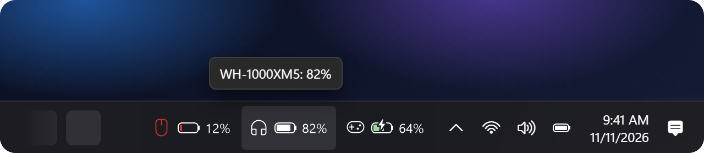
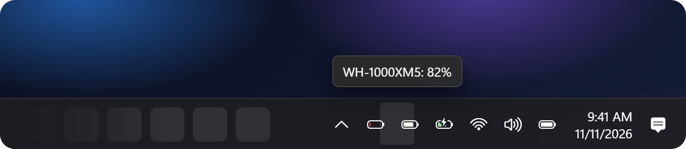
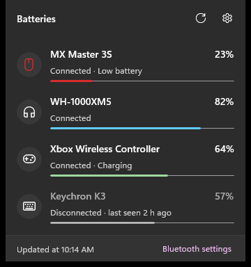

  

<h3 align="center">Headphones, mouse, keyboard or controller: their battery, always in sight on the taskbar.</h3>

  <!-- Temporary link: will point to the app's Store page once it's published. -->
  

  <b>Free</b> · <b>No ads</b> · <b>No data collection</b> · <b>Open source</b>
   
  <a href="README.md">Leer en español</a>

 

  
   
  <b>Right inside the taskbar</b>: every device with its battery and percentage.

 

  
   
  <b>Or next to the clock</b>: the same battery Windows 11 draws.

 

<table align="center">
  <tr>
    <td></td>
    <td valign="middle">
      <h3>One click shows it all</h3>
      🔋 <b>Just like the Windows 11 battery</b>  
      ⚡ <b>Green while charging</b>, red when low  
      🔔 <b>Alerts you</b> before they run out  
      🕓 <b>Last known level</b> of disconnected devices  
      🌗 <b>Light and dark theme</b>, English and Spanish
    </td>
  </tr>
</table>

  Works with Bluetooth headphones, speakers, mice, keyboards and controllers that report their battery to Windows, plus your laptop's own battery. 2.4 GHz USB receivers (Logitech, Razer…) aren't supported yet.

  

 

  

  
    <a href="../../issues/new/choose">Report a bug</a> ·
    <a href="docs/PRIVACY.md">Privacy</a> ·
    <a href="CONTRIBUTING.md">Contribute &amp; build</a> ·
    <a href="LICENSE">GPL-3.0 license</a>
  

