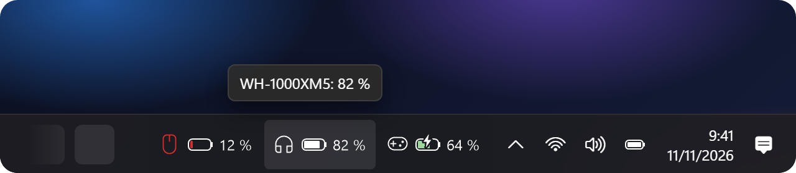
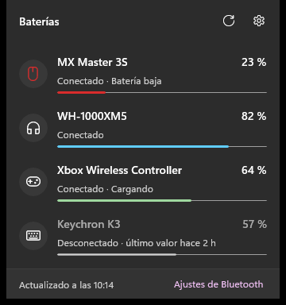

  

<h3 align="center">Auriculares, ratón, teclado o mando: su batería, siempre a la vista en la barra de tareas.</h3>

  <!-- Enlace provisional: se cambiará por la ficha de la app cuando esté publicada en la Store. -->
  

  <b>Gratis</b> · <b>Sin anuncios</b> · <b>Sin recoger datos</b> · <b>Código abierto</b>
   
  <a href="README.en.md">Read in English</a>

 

  
   
  <b>En la propia barra de tareas</b>: cada dispositivo con su batería y su porcentaje.

 

  
   
  <b>O junto al reloj</b>: la misma batería que dibuja Windows 11.

 

<table align="center">
  <tr>
    <td></td>
    <td valign="middle">
      <h3>Un clic y lo ves todo</h3>
      🔋 <b>Igual que la batería de Windows 11</b>  
      ⚡ <b>En verde al cargar</b> y en rojo cuando queda poca  
      🔔 <b>Te avisa</b> antes de que se apaguen  
      🕓 <b>Último nivel</b> de los que están desconectados  
      🌗 <b>Tema claro y oscuro</b>, en español e inglés
    </td>
  </tr>
</table>

  Funciona con auriculares, altavoces, ratones, teclados y mandos Bluetooth que informan de su batería a Windows, y con la del portátil. Los receptores USB de 2,4 GHz (Logitech, Razer…) todavía no.

  

 

  

  
    <a href="../../issues/new/choose">Avisar de un fallo</a> ·
    <a href="docs/PRIVACY.md">Privacidad</a> ·
    <a href="CONTRIBUTING.md">Colaborar y compilar</a> ·
    <a href="LICENSE">Licencia GPL-3.0</a>
  

