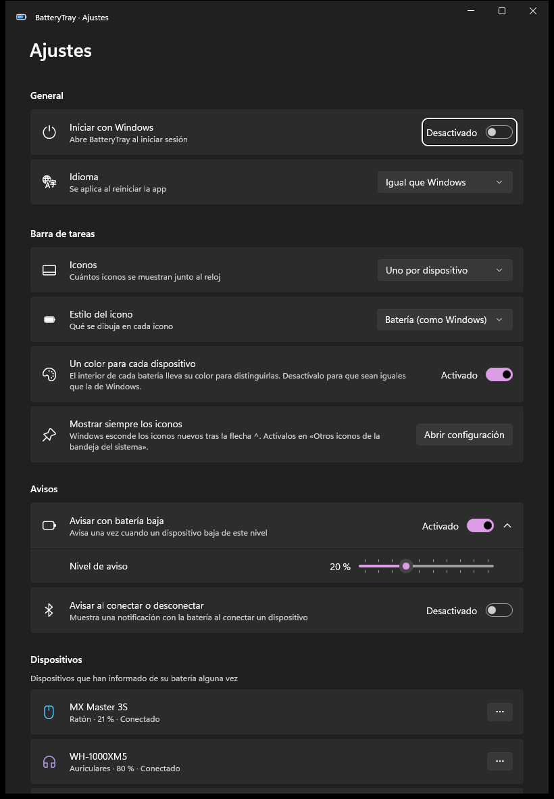

<p align="center">
  
</p>

<p align="center">
  <!-- Enlace provisional: se cambiará por la ficha de la app cuando esté publicada en la Store. -->
  <a href="https://apps.microsoft.com/search?query=BatteryTray"></a>
</p>

<p align="center">
  <a href="https://github.com/CuevasTech/BatteryTray/actions/workflows/ci.yml"></a>
  <a href="LICENSE"></a>
  
  
</p>

<p align="center">
  <b>Español</b> · <a href="#english">English</a>
</p>

---

**BatteryTray** pone la batería de tus auriculares, ratón, teclado o mando junto al reloj de Windows, con el mismo aspecto que el icono de batería de Windows 11. Gratis, de código abierto, sin anuncios y sin recoger ningún dato.

## ✨ Qué hace

<table>
  <tr>
    <td width="50%" valign="top">
      <h3>🔋 Iguales que la batería de Windows</h3>
      Cada dispositivo tiene su icono en la barra: la misma batería que dibuja Windows 11, con el <b>interior del color del dispositivo</b> para distinguirlos. El borde se pone <b>rojo</b> cuando queda poca batería y aparece el <b>rayo</b> al cargar.
      <br><br>
      
    </td>
    <td width="50%" valign="top">
      <h3>🪟 Panel al estilo Windows 11</h3>
      Un clic en el icono abre un panel como los de volumen o Wi-Fi: todos tus dispositivos, su nivel, si se están cargando y el último nivel de los que están desconectados.
      <br><br>
      
    </td>
  </tr>
  <tr>
    <td valign="top">
      <h3>🔔 Avisos cuando importa</h3>
      Una notificación cuando un dispositivo baja del nivel que elijas (una sola vez por descarga) y, si quieres, al conectarlo o desconectarlo.
    </td>
    <td valign="top">
      <h3>⚙️ Como la app Configuración</h3>
      Elige el estilo del icono, uno por dispositivo o uno solo, el color de cada dispositivo, ponles nombre, ocúltalos e inicia la app con Windows.
    </td>
  </tr>
</table>

<details>
  <summary><b>Ver la ventana de ajustes</b></summary>
  <p align="center"></p>
</details>

## 🎧 Dispositivos

| Funciona | Cómo |
|---|---|
| Auriculares y altavoces Bluetooth | Si Windows muestra su batería en *Configuración > Bluetooth y dispositivos* |
| Ratones, teclados y mandos Bluetooth LE | Con el mismo dato de Windows o con el servicio estándar de batería (GATT) |
| La batería del propio portátil | En el panel (en la barra ya la enseña Windows) |

**Todavía no:** receptores USB de 2,4 GHz (Logitech Unifying/Bolt, Razer, SteelSeries…). Cada marca usa su propio protocolo; están en la [hoja de ruta](PLAN.md).

> Algunos dispositivos no informan de su batería (muchos auriculares económicos) o lo hacen a saltos de 10 % o en tres niveles (0/50/100 %).

## 🚀 Primeros pasos

1. Instálala desde la [Microsoft Store](https://apps.microsoft.com/search?query=BatteryTray).
2. **Windows 11 esconde los iconos nuevos** tras la flecha `^`. Para verlos siempre: *Configuración > Personalización > Barra de tareas > Otros iconos de la bandeja del sistema* (en los ajustes de la app hay un botón que te lleva).
3. **Clic** en un icono: panel. **Clic derecho:** menú (actualizar, ajustes, iniciar con Windows, salir).

¿Sin dispositivos a mano? Activa *Ajustes > Avanzado > Modo demostración*.

<details>
  <summary><b>¿Por qué el icono es un poco más pequeño que el de Windows con la pantalla al 100 %?</b></summary>
  <br>
  Windows deja a las apps poner en la bandeja iconos de como mucho 16×16 píxeles a escala 100 %, mientras que su propia batería ocupa unos 20 píxeles de ancho. Por eso, a 100 % la de BatteryTray es el mismo diseño un poco más pequeño; a 125 % o más tiene exactamente el mismo tamaño. El dibujo está copiado píxel a píxel del de Windows 11: contorno de 1 px, hueco de 1 px, relleno y borne.
</details>

## 🐞 Si algo no funciona

*Ajustes > Avanzado > Copiar diagnóstico* copia un informe de lo que ve la app (las direcciones Bluetooth van ocultas). [Abre un aviso](../../issues/new/choose), pégalo y cuéntanos qué dispositivo usas.

## 🔒 Privacidad

BatteryTray **no usa Internet** y no recoge, envía ni comparte ningún dato. Solo guarda tus ajustes y el último nivel de cada dispositivo en tu propio equipo. Detalles en la [política de privacidad](docs/PRIVACY.md).

## 🛠️ Compilar

Necesitas el [SDK de .NET 10](https://dotnet.microsoft.com/download) en Windows (opcional: Visual Studio 2026 con «Desarrollo de aplicaciones WinUI»).

```powershell
# Pruebas
dotnet test --project tests/BatteryTray.Core.Tests/BatteryTray.Core.Tests.csproj
dotnet test --project tests/BatteryTray.Windows.Tests/BatteryTray.Windows.Tests.csproj -p:Platform=x64

# Ejecutar en desarrollo
dotnet run --project src/BatteryTray.App -r win-x64 -p:Platform=x64

# Paquete para la Microsoft Store (x64 + ARM64)
pwsh tools/Pack-Store.ps1 -Version 0.1.0
```

| Carpeta | Contenido |
|---|---|
| `src/BatteryTray.Core` | Modelos, ajustes, unión de lecturas, avisos y modo demostración |
| `src/BatteryTray.Windows` | Lectura de batería (Bluetooth, equipo) y dibujo de los iconos |
| `src/BatteryTray.App` | La app WinUI 3: bandeja, panel, ajustes, notificaciones |
| `tests/` | Pruebas automáticas |
| `tools/` | Generador de iconos, vista previa de la bandeja y empaquetado para la Store |
| `docs/brand/` | Logo y portada (SVG) |

¿Quieres añadir una marca, un idioma o corregir algo? Lee [CONTRIBUTING.md](CONTRIBUTING.md).

## 📄 Licencia

[GPL-3.0-or-later](LICENSE): puedes usarla, estudiarla, modificarla y compartirla; las versiones modificadas que distribuyas deben seguir siendo libres.

Gracias a [BlueGauge](https://github.com/iKineticate/BlueGauge) por documentar cómo expone Windows la batería de los dispositivos Bluetooth.

---

<a id="english"></a>

## English

<p>
  <a href="https://apps.microsoft.com/search?query=BatteryTray"></a>
</p>

**BatteryTray shows the battery of your headphones, mouse, keyboard or controller next to the Windows clock, looking just like the Windows 11 battery icon.** Free, open source, no ads, no data collection.

- **Windows-style tray icons:** the same battery Windows 11 draws, filled with each device's own color so you can tell them apart. The outline turns red when the battery is low and a bolt appears while charging. Or choose a single icon with the lowest level.
- **Windows 11–style flyout** with all your devices, and a settings window that looks like Windows Settings.
- **Low-battery alerts** (configurable level), optional connect/disconnect notifications, last known level for disconnected devices.
- Light/dark theme, accent color, high DPI and screen reader support. English and Spanish.
- **Demo mode** to try it without any devices.

**Supported:** Bluetooth headphones/speakers whose battery Windows already shows in Settings, Bluetooth LE mice/keyboards/controllers with the standard battery service, and the laptop's own battery. **Not yet:** 2.4 GHz USB receivers (Logitech, Razer…).

**Tip:** Windows 11 hides new tray icons behind the `^` arrow; turn them on in *Settings > Personalization > Taskbar > Other system tray icons*.

**Problems?** *Settings > Advanced > Copy diagnostics* (Bluetooth addresses are masked) and [open an issue](../../issues/new/choose).

**Privacy:** no internet access, no telemetry. See [docs/PRIVACY.md](docs/PRIVACY.md). **License:** [GPL-3.0-or-later](LICENSE).
